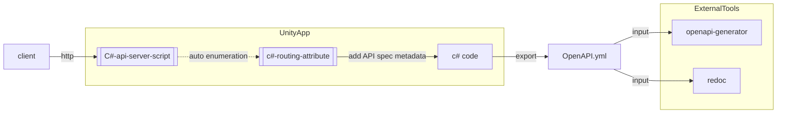

# usimplehttpserver : SimpleHttpServer for Unity

Note: This document is a machine translation of the original Japanese README and may contain inaccuracies.

!! Currently experimental !!
This package adds a simple HTTP API server capability to your Unity application.

By exposing app APIs, you can flexibly combine and use your app with other applications. For example:
- Operate or query the app from a web browser, curl, etc.
- Use for API-based end-to-end automated tests (a Gauge sample is included)
- Generate documentation by fetching the API specification from the `openapi.yml` endpoint
- Provide information to AI tools from the `openapi.yml` endpoint to make AI-driven app control easier
- Assign API call buttons to devices such as Elgato Stream Deck to trigger app shortcuts

## Concept

- Expose existing Unity app code as APIs with simple steps
- Gain interoperability with other applications through APIs
- Leverage existing web development tools and practices via OpenAPI.yml

**Non-goals**

- Keep it simple. Focus only on API server functionality; do not aim to be a general-purpose web server with static files, template engines, and other features.
- Do not aim for a security level suitable for publishing APIs directly to the internet.
  - Primarily intended for local use by the user on their own PC.
- Do not aim for full compliance with requests from web browsers; omit optional parts wherever possible.



## Installation

### dependencies

Please import the following first:

- com.cysharp.unitask
  - Refer to the official repository `https://github.com/Cysharp/UniTask.git` for installation.

- com.unity.nuget.newtonsoft-json
  - Open Package Manager and install by name: `com.unity.nuget.newtonsoft-json`.


### upm

Install this package from Package Manager via “Install package from git URL...” using the following URL:

```
https://github.com/uisawara/usimplehttpserver.git?path=Assets/UnityPackages/mmzkworks.usimplehttpserver
```

## Code examples

### Start/Stop the server

```c#
public sealed class SimpleHttpServerBehaviour : MonoBehaviour
{
    [SerializeField] private int port = 8080;
    private SimpleHttpServer? server;

    private void Awake()
    {
        DontDestroyOnLoad(gameObject);

        // Start HttpServer
        server = new SimpleHttpServer(port);
        // Register controllers based on attributes (routing configuration)
        server.RegisterControllersFrom(Assembly.GetExecutingAssembly());
        server.Start();
    }

    private void OnDestroy()
    {
        // Stop HttpServer
        server?.Stop();
        server = null;
    }
}
```

### URI routing

- Define routes via attributes.
- URL parameters are bound to method parameters.

```c#
[RoutePrefix("/api")]
public sealed class DemoController
{
    // GET /api/echo/hello?times=3 -> "hellohellohello"
    [HttpGet("/echo/{text}")]
    public string Echo(string text, int times = 1)
    {
        return string.Concat(Enumerable.Repeat(text, Math.Max(1, times)));
    }

    // GET /api/add/12/30 -> { "a":12, "b":30, "sum":42 }
    [HttpGet("/add/{a}/{b}")]
    public object Add(int a, int b)
    {
        return new { a, b, sum = a + b };
    }

    // POST /api/users  Body: {"name":"Alice","age":20}
    [HttpPost("/users")]
    public User CreateUser([FromBody] User req)
    {
        return new User { Id = Guid.NewGuid(), Name = req.Name, Age = req.Age };
    }

    // GET /api/users/{id}
    [HttpGet("/users/{id}")]
    public User GetUser(Guid id)
    {
        return new User { Id = id, Name = "Sample", Age = 42 };
    }
}

public sealed class User
{
    public Guid Id { get; set; }
    public string Name { get; set; } = "";
    public int Age { get; set; }
}
```

## Sample code

Sample code is included with the UPM package.
You can import it from Package Manager in the Unity Editor.

### ApplicationStateApiSample

Includes several sample API implementations.

| API Endpoint | Response                                                   |
| ------------ | ---------------------------------------------------------- |
| /api/echo/{text}  | Returns the provided text as an echo.                  |
| /api/state        | Returns the full application state in JSON.           |
| /api/state/{key}  | Returns the application state in JSON for the specified category.<br />You can use the following for key:<br />application: basic app info<br />environments: runtime environment variables and command-line arguments<br />runtime: runtime info |

### OpenApi endpoint

By enabling this, you can obtain the API specification in OpenAPI Specification format via the API.
The endpoint is `/openapi.yml`.

### gauge sample

This is sample code that uses the test automation framework [gauge](https://gauge.org/) to run API tests against a built binary.
- Launch the built binary with a command-line argument specifying the server listen port
- Access the API endpoints and validate responses

## API documentation generation (openapi.yml export)

You can export OpenAPI YAML to make creating API documents easier.

### How to use

- From the Unity Editor menu, select Tools/uSimpleHttpServer/Generate OpenAPI YAML to output `openapi.yml`.
- On first run, `Assets/Settings/OpenApiExportSettings` will be created.
  - Edit this file to change export settings.

## About AI Generation

- This repository contains code generated by AI.
